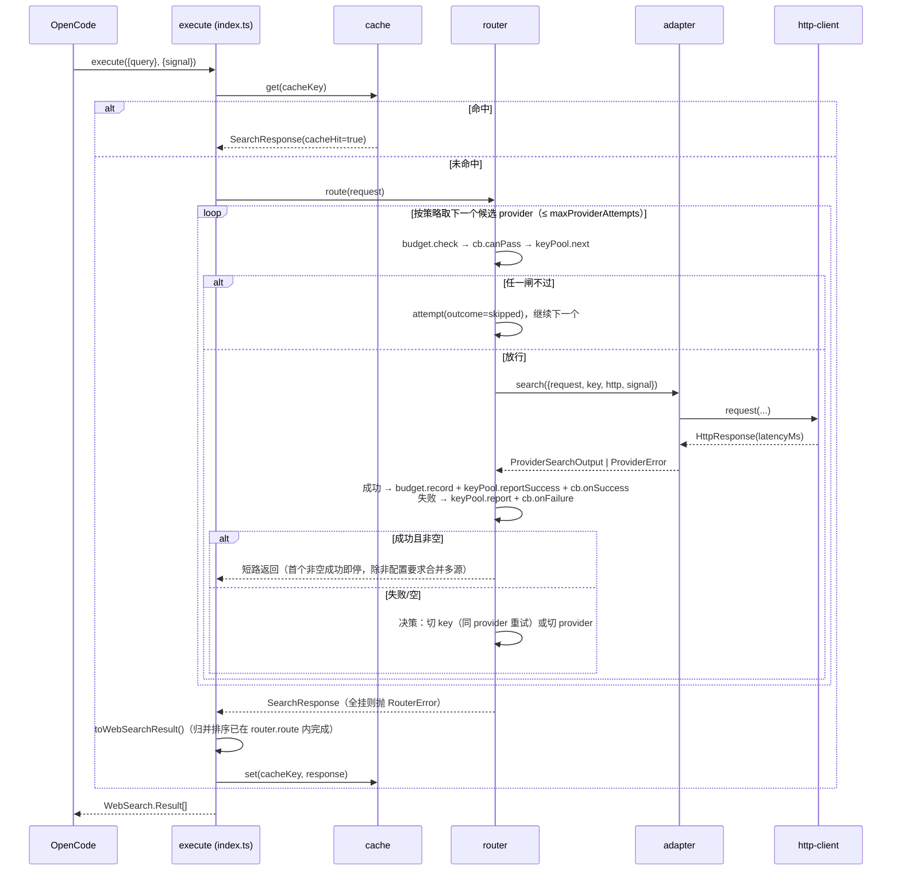
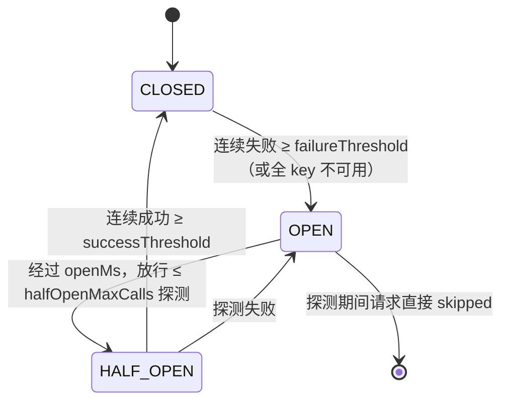
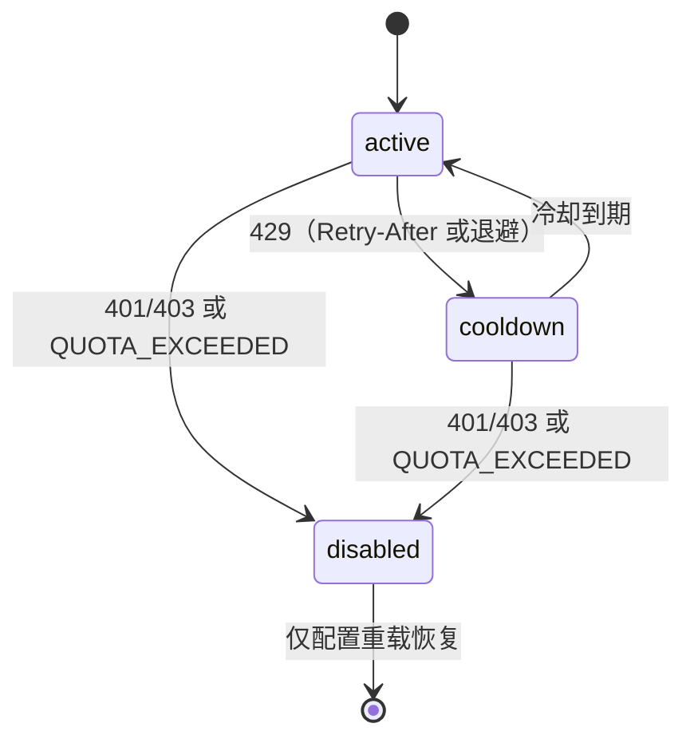

# 架构设计：opencode-websearch-loadbalanced（Phase 2）

> 依据：`docs/api-research-opencode.md`、`docs/api-research-providers-1.md`、`docs/api-research-providers-2.md`（2026-09-29 调研，结论以报告为准）。
> 范围：架构与接口契约（`src/types.ts`）。不含业务实现。

---

## 1. 核心架构决策：注册**一个**统一 provider

### 决策

用官方 `ctx.websearch.transform` 注册 **单个** provider（建议 `id: "loadbalanced"`），内部完成全部路由 / key pool / budget / 熔断；**不**为 6 个上游各注册一个 provider，也**不**注册普通 tool。

```ts
await ctx.websearch.transform((editor) => {
  editor.add({ id: "loadbalanced", name: "Load-balanced web search", execute })
  editor.default.set("loadbalanced")   // 仅在用户未显式配置 websearch.provider 时
})
await ctx.websearch.reload()
```

用户侧配合：`opencode.jsonc` 顶层 `"websearch": { "provider": "loadbalanced" }`。

### 理由（均出自调研报告，非推测）

1. **粒度匹配**。OpenCode 的 provider 选择、429 冷却、`websearch` 权限、`websearch.query` API 都以 *provider id* 为粒度。注册 6 个 = 把我们的 key pool / budget / circuit breaker 从决策环里剔除：OpenCode 直接调某一个的 `execute`，跨 provider fallback 被迫交给 OpenCode 的 `random` 模式——而 `random` 模式没有预算闸、没有熔断、其冷却状态**没有插件可读写 API**（报告 §3：文档未给出任何操作内置冷却的接口）。
2. **避免双重重试叠加**。OpenCode 内置行为是「429 → 换 provider 重试」；我们内部也有「5xx → 切 key → 切 provider」。若注册多个，两层重试独立运行、互不感知，会放大请求量并让 attempt 轨迹无法归因。
3. **权限与可观测性单一入口**。一个 id = 一个 permission 资源、一份 `websearch.providers` 列表、一段 `attempts[]` 轨迹。
4. **普通 tool 是劣选**。报告 §7.1 明确：走 `ctx.tool.transform` 会放弃 provider 选择 / 429 冷却 / `websearch` 权限语义，且与内置搜索工具并存造成两套入口。

### 代价与对策

| 代价 | 对策 |
|---|---|
| 内置 provider（`exa`/`tavily`/`parallel`）仍可被用户选中，绕过本插件的预算/key 轮询 | 文档声明：启用本插件后 `websearch.provider` 应指向 `loadbalanced`；不做激进拦截（YAGNI，OpenCode 无禁用单个内置 provider 的已文档化 API） |
| OpenCode 内置 429 冷却对我们的 id 生效，可能遮蔽内部细节 | 我们的 execute 内部已先于抛错消化掉可恢复失败；只有**全挂**才向上抛，此时 OpenCode 层冷却与我们方向一致，不冲突 |

---

## 2. 组件总览

```mermaid
flowchart TB
    OC["OpenCode ctx.websearch<br/>execute({query},{signal})"] --> IDX["index.ts<br/>execute 入口 + mapper"]
    IDX --> CACHE{"Cache<br/>TTL 命中?"}
    CACHE -- 命中 --> RET["toWebSearchResult()"]
    CACHE -- 未命中 --> ROUTER

    subgraph 内核 [内核（全部状态在 setup() 中构造，闭包持有）]
        ROUTER["router.ts<br/>候选过滤 + 策略排序"]
        CB["circuit-breaker.ts<br/>CLOSED/OPEN/HALF_OPEN"]
        BUDGET["budget.ts<br/>YYYY-MM 双 scope"]
        KEYPOOL["key-pool.ts<br/>轮询 + 冷却/禁用"]
        RANK["router.rankAndDedupe + utils/url<br/>跨 provider 归并/去重/排序"]
        HTTP["http-client.ts<br/>timeout/Retry-After/latency"]
    end

    ROUTER --> BUDGET
    ROUTER --> CB
    ROUTER --> KEYPOOL
    ROUTER --> ADAPTERS
    KEYPOOL --> ADAPTERS

    subgraph adapters [providers/*]
        P1[parallel] & P2[exa] & P3[tavily] & P4[you] & P5[serpapi] & P6[searxng]
    end
    ADAPTERS --> HTTP
    ADAPTERS --> RANK
    RANK --> CACHE
    RANK --> RET

    CFG["config.ts<br/>ctx.options → ResolvedConfig"] -.注入.-> 内核
    CFG -.-> ADAPTERS
```

依赖方向（单向，禁止反向 import）：

```
index.ts → router / cache / config
router   → circuit-breaker / budget / key-pool / providers/* / types
providers/* → http-client / types
config、http-client、cache、router(rankAndDedupe) → types
types → （无依赖，叶子）
```

---

## 3. 模块划分

| 文件 | 职责 | 关键边界（不做什么） |
|---|---|---|
| `src/index.ts` | `Plugin.define({ id, setup })`；在 `setup()` 内构造全部内核实例（闭包持有）；注册 websearch provider；返回 cleanup（清定时器） | 不含路由/重试逻辑；不创建 `tool.transform` |
| `src/types.ts` | 全部接口与常量表 | 无逻辑、无依赖 |
| `src/config.ts` | `ctx.options` → `ResolvedConfig`：类型收窄、默认值、校验（未知 provider、缺 key、priority 冲突）；**keys 三种写法（`"NAME"` / `"${NAME}"` / `{id, value}`）归一为 `ResolvedKeyRef`，并在 resolve 时解析 env**（缺失 → warning + 该 key 不可用，provider 可能被置 `enabled=false`） | 不读 yaml、不读文件；除 keys/baseUrl/options 的 `${VAR}` 展开外不解析结构性 env（env 解析在 config + key-pool） |
| `src/router.ts` | 请求编排：候选过滤（enabled → cache → budget → CB → key 可用）→ 策略排序 → 逐个派发 → 失败分类决策（切 key/切 provider/放弃）；`rankAndDedupe()` 跨 provider 排序去重 | 不直接 fetch；不改 key/CB 状态（调它们的 API） |
| `src/key-pool.ts` | 每 provider 的 key 集合：round-robin 取下一个 active key；429 → 按 Retry-After 冷却；401/403 → `disabled`（不自动恢复）；错误计数 | 不决定「失败后试谁」（router 决定）；不持有 HTTP |
| `src/circuit-breaker.ts` | 每 provider 一个状态机；提供 `canPass/onSuccess/onFailure/view()` | 不区分错误类型（router 归类后喂它） |
| `src/budget.ts` | `YYYY-MM` 周期键；provider/key 双 scope 计数；`check(target) → BudgetVerdict`；周期滚动自动重置 | 不硬编码任何额度——limit 全部来自配置 |
| `src/http-client.ts` | fetch 封装：AbortController 超时、latency 计时、Retry-After 解析、统一 headers | 不重试（重试决策在 router）；不感知 provider |
| `src/cache.ts` | 内存 Map + TTL + LRU 上限；key = 归一化请求指纹 | 不持久化（`ctx.storage` 属于 Phase 3 可选项） |
| `src/router.ts`（`rankAndDedupe`）+ `src/utils/url.ts` | 跨 provider 归并：URL 规范化去重 → 排序（见 §5） | 不使用跨 provider 的原生 score（无独立 `ranking.ts`） |
| `src/providers/*.ts` | 各上游协议适配：请求构造、响应→`SearchResult` 归一、错误信封→`ProviderError` 归类 | **不重试、不切 key、不熔断、不调 fetch**（只用注入的 `HttpClient`） |
| `src/utils/errors.ts` | `ErrorCode` 判定表（`classifyStatus` 按 provider × httpStatus）、`createProviderError` / `countsTowardCircuit` / `isRetryable` | — |

### 关键类职责边界

- **Router 与 KeyPool**：router 是唯一决策者，key-pool 是状态容器。router 问 `keyPool.next(provider)` 拿 key → 调 adapter → 把结果/错误分类回灌 `keyPool.report(provider, keyId, code)`。key-pool 绝不自己发起下一次尝试。
- **CircuitBreaker 与 KeyPool**：key 全部 `disabled`/`cooldown` ≠ 熔断。CB 只看 router 上报的「该 provider 本轮尝试结果」；OPEN 时 router 直接 `skipped`，不消耗 key 状态。
- **Budget 与两者**：budget 是**前置闸**（发请求前 `check`）；`record` **只在成功路径调用一次**（`router.ts`：裁决「budget 只在成功后记一次，禁止 usage+attempt 叠加」），失败尝试不记账；`countMode`/`unit` 语义在 `budget.record` 内部生效。
- **HttpClient 与 Adapter**：adapter 只组包/解包；超时、重试退避、Retry-After 提取全在 http-client + router。

---

## 4. 请求生命周期



补充规则：

1. **首个非空成功即短路**（默认）。跨 provider 合并多源属于可选扩展 `routing.merge: boolean`，Phase 2 不做（YAGNI）。
2. **全挂才抛错**：`results` 为空且 `attempts` 无 `ok`/`empty` → 抛 **`RouterError`**（`message` 聚合各 attempt 的 `provider:code[/status]`，经 `redact()`；非单个 `ProviderError`）；部分成功或空结果属正常返回。
3. `signal.aborted` → 立即终止，不再切换 provider。

---

## 5. 跨 Provider 排序与去重

约束（任务书 + 调研共同确认）：**原生 score 只在同 provider 内有意义**。报告佐证：Exa/Parallel 响应**根本没有 score 字段**，只有 Tavily（0..1 相关性）与 SearXNG（融合分）有；SerpApi 用 `position`；You.com 靠数组顺序。

因此排序键为字典序：

```
1. provider 层级   —— 按本次实际命中 provider 的 priority（配置决定；round_robin 下按本轮尝试顺序）
2. provider 内 rank —— 数组原始顺序（SerpApi=position、You/SearXNG=顺序、Tavily/Exa=返回序）
3. 新鲜度 time.published —— 有则新者在前（同层兜底）
```

`score` 不参与跨 provider 比较，仅存档供同 provider 内稳定排序（tie-break）。

去重：URL 规范化（去 fragment、去默认端口、query 参数排序、host 小写、尾斜杠归一）后以规范化 URL 为键保留**首次出现**（层级高者优先）。

---

## 6. 故障转移流程与状态机

### 6.1 单次尝试的错误分类决策表

| 分类信号 | ErrorCode | key 动作 | provider 动作 |
|---|---|---|---|
| 401 / 403（key 型 provider 的鉴权/scope 语义） | `AUTH` | 该 key → `disabled`（永久至重载） | 换同 provider 下一个 key；无可用 key → 换 provider |
| 429 | `RATE_LIMIT` | 冷却：`Retry-After` 优先（Exa/Tavily 文档承诺；Parallel/You 为 when-present；SerpApi 未公开）→ 缺失则指数退避 `baseCooldownMs·2ⁿ` 封顶 | 换同 provider 下一个 active key |
| 402 / 上游额度信号（Exa `NO_MORE_CREDITS`、Parallel 402、You 402） | `QUOTA_EXCEEDED` | 该 key `disabled` | 该 provider 本月标 `budget exhausted`（Budget 记一次 provider scope 停用）→ 换 provider |
| 400 / 404 / 422 | `BAD_REQUEST` | 不动 | **不重试**，换 provider（同 query 大概率仍失败） |
| 5xx | `SERVER_ERROR` | 每轮重试由 `keyPool.next()` 取下一个 active key，共 `retriesPerKey + 1` 次尝试 → 仍败则换 provider | 全 key 轮过 → `cb.onFailure` |
| 408 | `classifyStatus` 归 `UNKNOWN` → router 出厂归一为 `SERVER_ERROR`（retryable） | 参与重试轮转 | 退避后重试 → 换 provider | 
| fetch 失败 / DNS / TLS | `NETWORK_ERROR` | 换 key | 同上 |
| AbortController 超时 | `TIMEOUT` | 换 key | 同上 |
| 其他（含 SearXNG 403-HTML） | `UNKNOWN` | 不动 | 换 provider；**不计 CB 失败** |

> ⚠️ 403 语义按 provider 分派：SerpApi/You 的 403 属 key/scope（→ `AUTH`）；**SearXNG 的 403 = 实例禁用了 `format=json`（返回 HTML 页），与 key 无关** → `UNKNOWN`。Tavily 403 官方仅在 Research 端点提及，Search 场景按响应体探测。分类表在 `errors.ts` 中以 `provider × status → code` 显式维护，禁止全局一刀切。
>
> **CB 计数以代码为准**：`countsTowardCircuit()` 只认 `SERVER_ERROR` / `NETWORK_ERROR` / `TIMEOUT`（`src/utils/errors.ts`）。**`UNKNOWN` 不计熔断**——否则 SearXNG 实例配置问题（403 返回 HTML）会被误判成「provider 挂了」而打开电路。

### 6.2 Circuit Breaker 状态机（每 provider 独立）



- 只统计 `SERVER_ERROR / NETWORK_ERROR / TIMEOUT`；`AUTH/RATE_LIMIT/QUOTA_EXCEEDED` 由 key-pool/budget 处理，**不计入 CB**（否则会把「单 key 坏了」误判为「provider 挂了」）。
- `BAD_REQUEST` 不计入（是请求的问题）。

### 6.3 Key 状态机（每 key 独立）



### 6.4 Budget 状态

- 周期键 `YYYY-MM`（本地时区），每月首个 check 时滚动。
- `check()` 在**发请求前**执行；耗尽 → `skipped(budget_exhausted)`，不发网络请求。
- 双 scope：`provider:{id}` 与 `key:{keyId}` 同时 check，任一耗尽即跳过该 key。
- 额度全部来自配置，**代码中零硬编码**；`searxng` 无 key、无上游额度 → 默认不配 limit 即不受闸（仍可配 provider scope 防实例滥用）。

---

## 7. 配置 schema（任务书 §18 → OpenCode v2 官方机制）

**结论：不存在 `websearch.yaml`。** 报告 §4【文档确认】：V2 插件配置的唯一官方通道是 `opencode.jsonc` 的 `plugins[]` 对象条目 `{ package, options }` → `setup(ctx)` 内读 `ctx.options`；持久化状态用 `ctx.storage`。任务书的 yaml 需整体平移为下述 JSONC 结构（字段语义保留）。

```jsonc
// opencode.jsonc
{
  "$schema": "https://opencode.ai/config.json",
  "websearch": { "provider": "loadbalanced" },   // 顶层：选中本插件注册的 provider
  "plugins": [
    {
      "package": "./.opencode/plugins/websearch-loadbalanced",  // 或 npm 包名
      "options": {                                              // → ctx.options
        "providers": {
          "parallel": { "enabled": true, "priority": 10,
                        "keys": ["PARALLEL_API_KEY", "PARALLEL_API_KEY_2"],
                        "options": { "mode": "fast" } },
          "exa":      { "enabled": true, "priority": 20, "keys": ["EXA_API_KEY"] },
          "tavily":   { "enabled": true, "priority": 30, "keys": ["TAVILY_API_KEY"],
                        "options": { "search_depth": "basic" } },
          "you":      { "enabled": true, "priority": 40, "keys": ["YDC_API_KEY"] },
          "serpapi":  { "enabled": true, "priority": 50, "keys": ["SERPAPI_API_KEY"] },
          "searxng":  { "enabled": true, "priority": 99,
                        "baseUrl": "https://search.658658.xyz" }  // 无 key，最终 fallback
        },
        "routing":   { "strategy": "priority", "maxProviderAttempts": 6 },
        "http":      { "timeoutMs": 8000, "retriesPerKey": 2,
                       "retryBackoffMs": 400, "maxRetryBackoffMs": 8000 },
        "cache":     { "ttlMs": 300000, "maxEntries": 256 },
        "circuitBreaker": { "failureThreshold": 3, "openMs": 30000,
                            "halfOpenMaxCalls": 1, "successThreshold": 2 },
        "keyPool":   { "errorThreshold": 3, "baseCooldownMs": 5000, "maxCooldownMs": 300000 },
        "budget":    { "enabled": true, "unit": "requests", "countMode": "attempt",
                       "limits": [
                         { "scope": "provider", "target": "serpapi", "limit": 250 },
                         { "scope": "key", "target": "exa:9f3a7c21", "limit": 10000 }
                       ] },
        "logging":   { "level": "info" }
      }
    }
  ]
}
```

要点：

- **key 走环境变量名**（`keys: ["EXA_API_KEY"]`），解析时读 `process.env` → 明文不进配置文件、不进 git；`keysInline` 为兜底且日志中脱敏。
- `websearch.yaml` 里若出现的字段此处没有（如硬编码额度），一律不迁入——额度只进 `budget.limits`，且是**用户配置值**而非代码常量。
- 配置合并语义：多份 `opencode.jsonc` 的 `plugins` 从低到高合并（报告 §4.2），options 整体按 `providers.<id>` 深合并，冲突以高优先级配置文件为准。
- env 不是官方配置通道，故 env 仅用于**密钥材料**，结构性配置一律走 `options`。

---

## 8. 密钥安全

1. 明文只存在于 `ResolvedKey.secret`（内存），生命周期限单次 attempt。
2. `keyId = sha256(secret).slice(0,8)`，日志 / `ProviderError.keyId` / `SearchResult.keyId` / `SearchResponse` 全部只允许 keyId。
3. SerpApi 的 key 在 URL query → http-client 对外暴露的错误 message 必须重写 URL（去 query 或以 `api_key=***` 掩码）。
4. adapter 归一第三方错误体时截断 body（≤512B）并做 key 模式扫描（`tvly-…`、`sk-…` 等）。
5. `logging.level=debug` 也不打印 secret——脱敏在序列化层，不靠日志级别开关。

---

## 9. 各 adapter 的归一映射要点（来自调研报告）

| provider | 请求要点 | 结果映射 | 错误信封 | Retry-After |
|---|---|---|---|---|
| parallel | `POST /v1/search`，`search_queries:[q]`（必填），`mode`，`advanced_settings.max_results` | `results[].url/title`，`content = excerpts.join("\n")`，`time.published = parse(publish_date)`，无 score | `{"error":{message,detail}}` | 未承诺 → 退避兜底 |
| exa | `POST /search`，`query`，`numResults`，`contents.text/highlights` | `results[].url/title/text→content`，`publishedDate`（YYYY-MM-DD 估算），无 score | `{"requestId","error","tag"}` | 有则遵守 |
| tavily | `POST /search`，`query`，`max_results≤20`，`Authorization: Bearer tvly-…` | `results[].url/title/content`，`score`，`published_date`（需开关），`usage.credits`→budget | `{"detail":{error}}` | 有则遵守 |
| you | `POST ydc-index.io/v1/search`，`X-API-Key`，`count`/`freshness`/`safesearch` | **`results.web[]` 分区**：`url/title/description+snippets→content`，`page_age→time.published`；`X-RateLimit-*`→预节流 | `{"detail":…}` / `{"error",…}` | when present |
| serpapi | `GET /search?engine=google&q&api_key`（**无 `num`**，翻页用 `start`） | `organic_results[].link→url`，`snippet→content`（**可缺失**），`position→rank`，**无稳定 date** | 单键 `{"error":…}` | 官方未公开 |
| searxng | `GET /search?q&format=json`（无 key），`safesearch=0..2`，`time_range` 含 `week` | `results[].url/title/content`，`score`，`publishedDate`(可 null)，顺序即 rank | 400/500 = `{"error":…}` JSON；**403 = HTML**（格式被禁）→ `UNKNOWN` | 无（限流在 CDN 层） |

---

## 10. 与任务书不一致处 / 未决项

| # | 项 | 说明 |
|---|---|---|
| 1 | `websearch.yaml` | 任务书沿用 V1/自定义习惯；V2 **无独立配置文件**，已整体落到 `opencode.jsonc → plugins[].options → ctx.options`（§7）。字段语义保留，格式变更。 |
| 2 | 注册单 provider vs 多 provider | 任务书未定；本设计**明确单 provider**（§1）。若任务书原文默认「注册 6 个」，属需修正项。 |
| 3 | 额度数字 | 任务书若引用各家免费额度（SerpApi 250/月、SearXNG 无额度等），仅能作为**配置示例默认值**出现在文档，不得进代码；且调研显示这些数字会变（Exa $10/月、You $100 一次性）。 |
| 4 | `Retry-After` 普适假设 | 「优先 Retry-After」保留，但只有 Exa/Tavily 承诺；Parallel/You 是 when-present、SerpApi 完全未公开 → 必须有退避兜底（§6.1），不能把缺失当异常。 |
| 5 | 401/403 禁用 key | 对 key 型 provider 成立；**SearXNG 403 与 key 无关**（HTML 页，格式被禁），须按 provider 分派分类表（§6.1）。 |
| 6 | native score 跨 provider 排序 | 与任务书一致（只在同 provider 内用）。补充事实：**6 家中仅 Tavily/SearXNG 有 score**，Exa/Parallel 连字段都没有 → 跨 provider 排序主键必然是 priority + rank（§5）。 |
| 7 | 月度 budget 计数口径 | SerpApi 官方「仅成功计数、缓存命中免费」→ `countMode: success` 只对它有意义；统一 `attempt` 会高估 SerpApi 消耗（§6.4）。 |
| 8 | `time.published` 单位 | 官方 OpenAPI 只写 `number`，秒/毫秒未标明 → adapter 统一产出毫秒，mapper 不再转换；若实测 OpenCode 展示异常再切。**未决项**。 |
| 9 | `execute` 抛错的官方行为 | 报告未文档化「execute 抛异常时 OpenCode 如何呈现」→ 设计按「全挂才抛、抛脱敏错误」处理，Phase 3 实测验证。**未决项**。 |
| 10 | 任务书要求的 `ctx.storage` 持久化（预算跨重启、禁用 key 跨重启） | 报告确认 `ctx.storage` 可用但属增强项；Phase 2 先内存态（重启清零），持久化留作 Phase 3，接口上 budget/key-pool 的 state 已可序列化（`BudgetState`/`KeyState`）预留。 |
| 11 | 硬性禁止项核对 | 零硬编码额度（budget.limits 全配置化）、零硬编码 key（env 引用）、非全挂不返回错误（§4 规则 2）——三条均在架构层强制。 |
