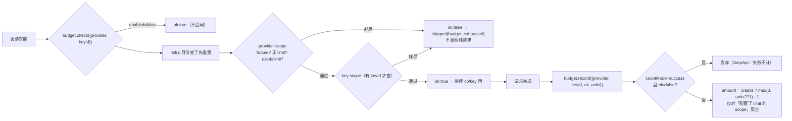

# 月度预算（MonthlyBudgetManager）

> 最终事实：`src/budget.ts` + `src/types.ts` §5；配置校验见 `src/config.ts`（§budget）；架构背景 `docs/architecture.md` §6.4。
> **额度全是配置，零硬编码**：`limit` 只来自 `budget.limits`；未配置额度 = 不受闸；代码中不存在任何默认额度数字。

## 1. 核心概念

| 概念 | 取值/规则 | 来源 |
|---|---|---|
| 周期 | **`YYYY-MM`（本地时区）**，`periodOf(t)` = `年-补零月` | `budget.ts` |
| 滚动重置 | `check()` / `record()` / `markExhausted()` 首次发现 `state.period !== 当前月` → **整体重置** `entries` 与 `forced`（自动，无定时器） | `roll()` |
| scope | `provider`（target = `ProviderID`）与 `key`（target = `keyId` 指纹，如 `exa:9f3a7c21`）**同时 check，任一耗尽即 skip** | `check()` |
| `unit` | `"requests"` \| `"credits"` \| `"credit"` \| `"usd"` \| `"unlimited"`（默认 `requests`；归一：`credit`→`credits`、`unlimited`→等价未设 limit、`usd`→按 `credits` 计） | `config.ts` 输入侧 `BudgetUnitInput`，resolved 侧 `BudgetConfig.unit` 恒为 `requests\|credits` |
| `countMode` | `"attempt"`（默认，每次调用计）\| `"success"`（仅成功计，**SerpApi 官方口径**）——但 **router 只在成功后调用 `record` 一次**，故当前两种口径实际等价 | `BudgetConfig` |
| `enabled` | boolean，默认 `true`；`false` → `check()` 恒 `ok:true`、`record()` 直接返回 | `BudgetConfig` |

> ⚠️ **归一规则（`budget.unit`）**：
> - `credit` → 归一为 `credits`（单复数同义）
> - `unlimited` → 归一为**等价「未设 limit」**（不因 unit 强加额度；显式 `limits` 条目仍正常生效）
> - `usd` → **按 `credits` 计**（USD 换算表暂不做，YAGNI）；金额语义不做精确换算
> - 已核对落地（`src/config.ts` L177-185 归一、L234-238 unlimited 丢弃 limits；`src/types.ts` `BudgetUnitInput` 输入侧收别名，resolved `BudgetConfig.unit` 恒为 `requests\|credits`）。
> - 想「不限额」→ 不配该 scope 的 limit、或 `unit: "unlimited"`、或 `budget.enabled: false`。`credits` 是按 `adapter.cost()` 加权的相对单位。

## 2. 配置 schema

```jsonc
"budget": {
  "enabled": true,
  "unit": "requests",          // "requests" | "credits" | "credit"(→credits) | "usd"(按 credits) | "unlimited"
                                // 已落地：config.ts 归一 credit/usd→credits、unlimited→丢弃 limits
  "countMode": "attempt",      // "attempt" | "success"
  "limits": [
    { "scope": "provider", "target": "serpapi",  "limit": 250 },
    { "scope": "provider", "target": "searxng",  "limit": 500 },
    { "scope": "key",      "target": "exa:9f3a7c21", "limit": 10000 }
  ]
}
```

`config.ts` 校验规则：

| 规则 | 级别 |
|---|---|
| `limits` 非数组 | **error** |
| 条目非对象 / `scope` 非 `provider|key` / `target` 缺失或非字符串 / `limit` 非正有限数 | **error**（该条目跳过） |
| `scope=provider` 但 `target` 不是六家之一 | **error** |
| `scope=key` 但 `target` 不匹配 `^[A-Za-z0-9]+:[0-9a-f]{8,64}$`（keyId 指纹形态） | warning |
| 同 `scope:target` 重复条目 | warning，**后者覆盖前者** |
| `unit` / `countMode` / `enabled` 非法 | warning + 回退默认值 |

## 3. 判定与记账流程



### `check()` 语义

返回 `BudgetVerdict = {ok:true} | {ok:false, scope, target, limit, used}`：
- **未配置该 scope 的 limit → `{ok:true}`（零硬编码）**
- `forced[scope:target:period]` 存在 → `{ok:false}`（上游 402 等强制停用，即使没配 limit）
- `used >= limit` → `{ok:false}`
- provider 先查，通过后再查 key；任一不过即耗尽

### `record()` 语义

- **router 只在成功路径调用一次**（`router.ts`：裁决「budget 只在成功后记一次，禁止 usage+attempt 叠加」）——失败尝试不进 `record`，故 `countMode` 两种取值在 router 调用点实际等价（`budget.ts` 内部规则仍保留）
- `unit=requests` → 每次 +1；`unit=credits` → `+max(0, units ?? 1)`（`units` 来自 router 传入：tavily 取 `usage.units`，其余恒 1）
- `countMode=success` 且 `ok=false` → **不计数**（防御分支；router 当前不会以 `ok:false` 调 record）
- **只对配置了 limit 的 scope 建 entry 累加**（无 limit 不记，避免无意义状态增长）

### `markExhausted(scope, target)` 语义（上游额度信号）

- 有 limit → `used = max(used, limit)`（本周期立即耗尽）
- 无 limit → 写 `forced[scope:target:period] = true`（本周期强制停用）
- 触发点：上游 402 / `QUOTA_EXCEEDED`（Exa `NO_MORE_CREDITS`、Parallel 402、You 402 等），由 router 在 `keyPool.report(..., QUOTA_EXCEEDED)` 之外同步调用

## 4. 耗尽与重置行为总览

| 事件 | 行为 |
|---|---|
| scope 耗尽 | router 在**发请求前** skip 该 provider/key（`ProviderAttempt.skippedReason="budget_exhausted"`），不烧网络 |
| 跨月（本地时区） | 下一次 `check/record` 自动把 `entries`、`forced` 清空并切到新 `period` → **月度自动重置**，无需 cron |
| 上游 402 | `markExhausted` 立即停用该 scope 到月底（`forced` 或 `used=limit`） |
| 配置变更（新 limit） | `findLimit` 每次实时读 `config.limits`；已有 `entry.limit` 是建档时快照，跨月重置后按新 limit 建档 |

## 5. 状态序列化（Phase 3 持久化留接口）

- `serialize(): BudgetSnapshot` = `{period, entries, forced?}`（`JSON.parse(JSON.stringify(state))`，**不含 key 明文**，`entries` 键为 `${scope}:${target}:${period}`）
- `restore(snapshot)` 回填 `period/entries/forced`
- `entries(): BudgetEntry[]` 供诊断输出：`{scope, target, period, limit, used, unit}`

## 6. 各 provider 配置额度的参考写法（数字来自调研，**仅示例，非代码默认值**）

> 抓取日期 2026-09-29，可能变化；见 `docs/providers.md` 各节 Free quota。

```jsonc
"limits": [
  { "scope": "provider", "target": "serpapi", "limit": 250 },     // SerpApi Free 250/月
  { "scope": "provider", "target": "tavily",  "limit": 1000 },    // Tavily 1,000 credits/月 → 配 unit:"credits"
  { "scope": "provider", "target": "exa",     "limit": 10 },      // Exa $10 credits/月（credits 口径）
  { "scope": "key",      "target": "you:1a2b3c4d", "limit": 100 } // You $100 一次性、无 spending caps → 必须自建 cap
]
```

注意：
- **You 官方无 spending caps**（Auto Top-Up）→ 不配 limit 等于不设防
- **SerpApi 计费仅成功计数** → 该 provider 建议 `countMode` 语义单独考虑；当前 `countMode` 是全局配置，统一 `attempt` 会高估 SerpApi 消耗（`docs/architecture.md` §10 未决项 7）
- SearXNG 无上游额度，可不配；配 provider scope 仅用于防实例滥用
