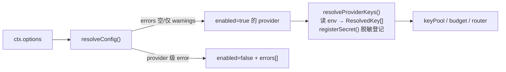

# 配置参考（opencode.jsonc → plugins[].options → ctx.options）

> **配置以 `src/config.ts` + `src/types.ts` 为最终事实**；架构背景见 `docs/architecture.md` §7。
> **不存在生效的 `websearch.yaml`**：V2 唯一官方配置通道是 `opencode.jsonc` 的 `plugins[]` 对象条目 `{ package, options }` → `setup(ctx)` 内读 `ctx.options`（https://opencode.ai/v2/docs/plugins ）。env 只用于**密钥材料**，结构性配置一律走 `options`。

## 外置配置文件（可选）

`opencode.jsonc` 的插件项可保持纯字符串（无 `options`），全部配置放独立 JSONC 文件：

```jsonc
// opencode.jsonc
{ "plugins": ["opencode-websearch-loadbalanced"] }   // 或 { "package": "…" }，不写 options
```

- **路径**：`ctx.options.configFile`（`~` 展开为 homedir）；未给则探测默认路径
  `~/.config/opencode/websearch-loadbalanced.jsonc`。默认路径**不存在 → 静默走 inline**（无告警）；
  显式 `configFile` 读失败 → warning + 回退 inline。
- **格式**：JSONC —— 支持 `//` 行注释与 `/* … */` 块注释（内置状态机剥离，字符串字面量内的 `//`
  不会被截断，如 `"baseUrl": "https://host//path"`），**也支持尾逗号**（数组/对象最后一个元素后的 `,`
  容忍，字符串字面量内的 `,]`/`,}` 不受影响）；其余解析失败 → warning + 回退
  inline，不抛错、插件照常启动。
- **合并规则**：文件为 base，inline `ctx.options` **顶层键整体覆盖**（**不做深合并**）——
  inline 只要出现 `providers` / `routing` / `http` / `cache` / `circuitBreaker` / `keyPool` /
  `budget` / `logging` 中的某键，该块就**整个**替换文件里的同名块，未出现的键才保留文件值。
- `configFile` 只在输入侧生效，不进 `ResolvedConfig`；文件内容随后按 §2–§4 同一套 schema 校验。
- 完整可改示例见 `examples/websearch.config.jsonc`。

```jsonc
// ~/.config/opencode/websearch-loadbalanced.jsonc（外置配置文件）
{
  // 密钥只写环境变量名，明文不进配置、不进 git
  "providers": {
    "exa":     { "enabled": true, "priority": 20, "keys": ["EXA_API_KEY"] },
    "searxng": { "enabled": true, "priority": 99 }   // 无 key，最终 fallback
  },
  "routing": { "strategy": "priority", "maxProviderAttempts": 6 }, /* 行内注释也允许 */
  "logging": { "level": "info" }
}
```

```jsonc
// opencode.jsonc：显式指定外置文件（可选；不写则探测默认路径）
{ "plugins": [{ "package": "opencode-websearch-loadbalanced", "options": { "configFile": "~/my-websearch.jsonc" } }] }
```

## 1. 顶层结构

```jsonc
// opencode.jsonc
{
  "$schema": "https://opencode.ai/config.json",
  "websearch": { "provider": "loadbalanced" },   // 选中本插件注册的 provider
  "plugins": [
    {
      "package": "./.opencode/plugins/websearch-loadbalanced",   // 或 npm 包名
      "options": { /* ↓ 见 §2 */ }
    }
  ]
}
```

`resolveConfig(options)` **不抛错**：问题全部进 `errors[]` / `warnings[]`，经 `redact()` 脱敏。
- `errors` → 阻断对应 provider 启用（`enabled=false`）或该字段回退默认值
- `warnings` → 不阻断，仅记录

## 2. 完整 schema 与默认值

### 2.1 `providers.<id>`（六家：`parallel` / `exa` / `tavily` / `you` / `serpapi` / `searxng`）

| 字段 | 类型 | 默认值 | 说明 |
|---|---|---|---|
| `enabled` | boolean | **未配置该 provider → `false`；配置了但没写 `enabled` → `true`** | 未出现在 `providers` 里的 provider 一律不启用 |
| `priority` | number ≥0 | parallel 10 / exa 20 / tavily 30 / you 40 / serpapi 50 / searxng 99 | 数字小者优先；**同值冲突 → warning**，排序退化为配置枚举序 |
| `baseUrl` | string（http/https） | `https://api.parallel.ai` / `https://api.exa.ai` / `https://api.tavily.com` / `https://ydc-index.io` / `https://serpapi.com` / `https://search.658658.xyz` | 支持 `${VAR}` 展开；非法 URL → **error，该 provider 标记不可用** |
| `keys` | `KeyEntry[]` | `[]` | 三种写法，见 §3 |
| `keysInline` | string[] | `[]` | **明文直写（不推荐）**；非空时 warning 提示「日志中仅显示 keyId」；必须为字符串数组否则 error |
| `options` | object | `{}` | adapter 专属参数（`parallel.mode` / `tavily.search_depth` / `serpapi.engine` …），不透明透传；字符串值展开 `${VAR}`（缺失仅 warning，不置灰 provider）；非对象 → error |
| `timeoutMs` | number ≥1 | 继承 `http.timeoutMs` | 非法 → warning 并回退 |

**环境变量缺失行为（不导致启动失败）**：
- `keys` 某条引用的 env 未设置/为空 → `warning`「环境变量 X 未设置（key 不可用）」，**该 key 不可用**，继续用其余 key
- 非 keyless provider 且**没有任何可用 key**（env 全缺或未配 keys）→ `warning` + `enabled=false`（provider 不可用，插件正常启动）
- `searxng` 是唯一 keyless provider（`KEYLESS_PROVIDERS`），无 key 也可用
- `providers.<id>` 里出现未知 provider 名 → `error`（合法值：`parallel, exa, tavily, you, serpapi, searxng`）

### 2.2 通用块

| 块 | 字段 | 类型 | 默认值 | 非法值处理 |
|---|---|---|---|---|
| `routing` | `strategy` | `"priority"` \| `"round_robin"` | `"priority"` | warning + 回退 priority |
| | `maxProviderAttempts` | int ≥1 | `6` | warning + 回退 6 |
| `http` | `timeoutMs` | int ≥1 | `8000` | warning + 回退 8000 |
| | `retriesPerKey` | int ≥0 | `2` | warning + 回退 2 |
| | `retryBackoffMs` | int ≥0 | `400` | warning + 回退 400 |
| | `maxRetryBackoffMs` | int ≥0 | `8000` | warning + 回退 8000；**< retryBackoffMs 时自动取较大值** |
| `cache` | `ttlMs` | int ≥1 | `300000`（5 分钟） | warning + 回退 |
| | `maxEntries` | int ≥1 | `256` | warning + 回退 |
| `circuitBreaker` | `failureThreshold` | int ≥1 | `3` | warning + 回退 |
| | `openMs` | int ≥1 | `30000` | warning + 回退 |
| | `halfOpenMaxCalls` | int ≥1 | `1` | warning + 回退 |
| | `successThreshold` | int ≥1 | `2` | warning + 回退 |
| `keyPool` | `errorThreshold` | int ≥1 | `3` | warning + 回退 |
| | `baseCooldownMs` | int ≥0 | `5000` | warning + 回退 |
| | `maxCooldownMs` | int ≥0 | `300000` | warning + 回退；**< baseCooldownMs 时自动取较大值** |
| `budget` | `enabled` | boolean | `true` | 非 boolean 视为 `true` |
| | `unit` | `"requests"` \| `"credits"` \| `"credit"` \| `"usd"` \| `"unlimited"` | `"requests"` | 归一 `credit→credits` / `unlimited→等价未设 limit`（丢弃 limits）/ `usd→按 credits`；非法 → warning + 回退 `requests`（`config.ts` L177-185 已落地） |
| | `countMode` | `"attempt"` \| `"success"` | `"attempt"` | 非法 → warning + 回退 `attempt` |
| | `limits` | `BudgetLimit[]` | `[]` | 见 `docs/budget.md`；非数组 → error |
| `logging` | `level` | `"silent"` \| `"error"` \| `"info"` \| `"debug"` | `"info"` | 非法 → warning + 回退 `info` |

> ✅ **`budget.unit` 枚举（已落地核对）**：`requests` / `credits` / `credit`（归一→`credits`）/ `usd`（按 `credits` 计，USD 换算表暂不做）/ `unlimited`（等价未设 limit，丢弃 limits）。输入侧类型 `BudgetUnitInput`，resolved 侧 `BudgetConfig.unit` 恒为 `requests|credits`（`src/config.ts` L177-185、L234-238；`tests/config.test.ts` 6 例别名测试）。`budget.enabled=false` 同样等价于「不限额」。`budget.countMode` 只有 `attempt` / `success`。

## 3. keys 的三种等价写法

`src/config.ts` `normalizeKeyEntry()` 把三者归一为 `ResolvedKeyRef { id, envName }`，明文**不进** `ResolvedConfig`：

```jsonc
"exa": {
  "enabled": true,
  "keys": [
    "EXA_API_KEY",                            // ① 纯 env 名
    "${EXA_API_KEY_2}",                       // ② 插值字符串
    { "id": "primary", "value": "${EXA_API_KEY_3}" }   // ③ 对象：显式槽位 id
  ]
}
```

规则（均出自 `src/config.ts`）：
- 对象写法 `value` 必须是 env 引用（裸名或 `${…}`）；`id` 缺省由 env 名派生
- 同一 provider 内**重复引用同一 env 名 → 去重**（warning）
- 条目既非 env 名也非 `${VAR}` 形态 → `error`（该 provider 标记不可用）
- 明文兜底：`keysInline: ["sk-…"]`（不推荐，warning），`resolveProviderKeys()` 同时读 keys env + keysInline，**同一 secret 去重**
- key 身份：`keyId = fingerprint(provider, secret) = "<provider>:<sha256(secret) 前 8 hex>"`，如 `exa:9f3a7c21`；所有日志/错误/预算归因只用 keyId

## 4. 完整示例

```jsonc
{
  "$schema": "https://opencode.ai/config.json",
  "websearch": { "provider": "loadbalanced" },
  "plugins": [
    {
      "package": "./.opencode/plugins/websearch-loadbalanced",
      "options": {
        "providers": {
          "parallel": { "enabled": true, "priority": 10,
                        "keys": ["PARALLEL_API_KEY", "PARALLEL_API_KEY_2"],
                        "options": { "mode": "fast" } },
          "exa":      { "enabled": true, "priority": 20, "keys": ["EXA_API_KEY"] },
          "tavily":   { "enabled": true, "priority": 30, "keys": ["TAVILY_API_KEY"],
                        "options": { "search_depth": "basic" } },
          "you":      { "enabled": true, "priority": 40, "keys": ["YDC_API_KEY"] },
          "serpapi":  { "enabled": true, "priority": 50, "keys": ["SERPAPI_API_KEY"] },
          "searxng":  { "enabled": true, "priority": 99,
                        "baseUrl": "https://search.658658.xyz" }   // 无 key，最终 fallback
        },
        "routing":   { "strategy": "priority", "maxProviderAttempts": 6 },
        "http":      { "timeoutMs": 8000, "retriesPerKey": 2,
                       "retryBackoffMs": 400, "maxRetryBackoffMs": 8000 },
        "cache":     { "ttlMs": 300000, "maxEntries": 256 },
        "circuitBreaker": { "failureThreshold": 3, "openMs": 30000,
                            "halfOpenMaxCalls": 1, "successThreshold": 2 },
        "keyPool":   { "errorThreshold": 3, "baseCooldownMs": 5000, "maxCooldownMs": 300000 },
        "budget":    { "enabled": true, "unit": "requests", "countMode": "attempt",
                       "limits": [
                         { "scope": "provider", "target": "serpapi", "limit": 250 },
                         { "scope": "key", "target": "exa:9f3a7c21", "limit": 10000 }
                       ] },
        "logging":   { "level": "info" }
      }
    }
  ]
}
```

## 5. 解析流程与关键不变量



不变量（`src/config.ts` 文件头 + `docs/architecture.md` §8）：
1. **零硬编码额度**：`budget.limits` 只来自配置，无配置 = 不受闸
2. **零硬编码 key**：配置只存 env 引用，明文仅存在于内存 `ResolvedKey.secret`
3. 所有 `errors`/`warnings` 过 `redact()`，绝不携带 key 明文
4. 配置合并：多份 `opencode.jsonc` 的 `plugins` 从低到高合并（`~/.config/opencode` → `./opencode.jsonc` → `./.opencode/opencode.jsonc`），按 `providers.<id>` 深合并，高优先级覆盖
