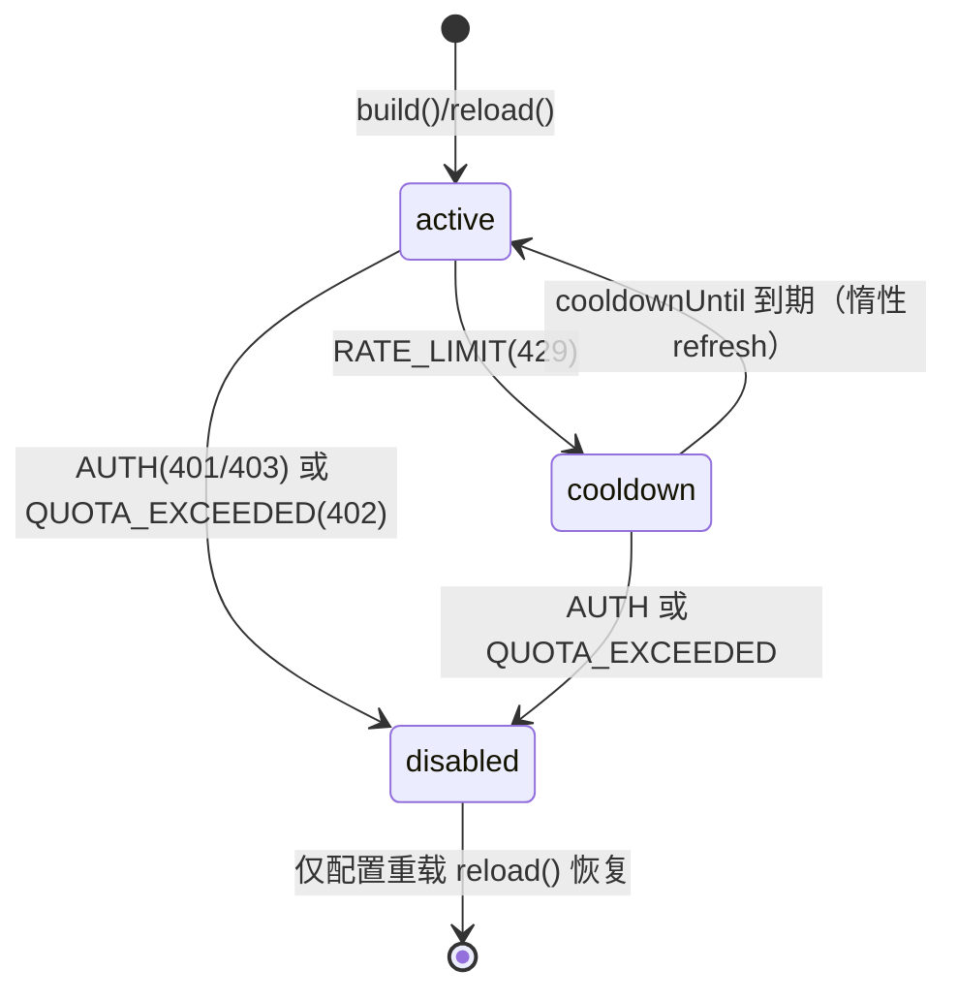
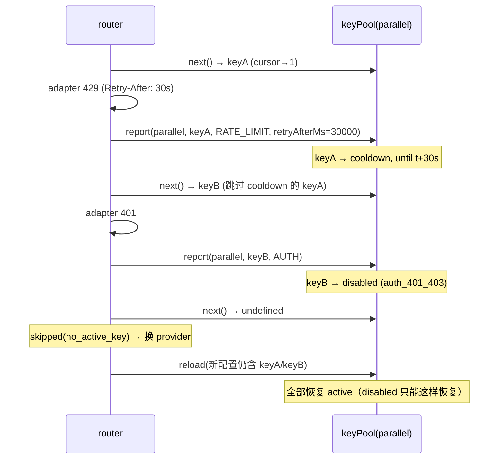

# Key Rotation（KeyPool 状态机）

> 事实来源：`src/key-pool.ts`（最终事实）+ `src/types.ts` §3 + `docs/architecture.md` §6.3。
> 边界：**KeyPool 只是状态容器**——不发起下一次尝试、不持有 HTTP、不决定「失败后试谁」。router 是唯一决策者：问 `next()` 拿 key → 调 adapter → 把结果/错误分类回灌 `report()`。

## 1. 状态机（每 key 独立）



`KeyStatus = "active" | "cooldown" | "disabled"`（`src/types.ts`）。

| 状态 | 进入条件 | 退出条件 | 字段 |
|---|---|---|---|
| `active` | 初始；cooldown 到期 | 被 429/401/403/402 命中 | `consecutiveErrors` 独立计数 |
| `cooldown` | `report(code="RATE_LIMIT")` | `now >= cooldownUntil`（`next()`/`hasActive()` 内惰性刷新） | `cooldownUntil = t + 冷却时长` |
| `disabled` | `AUTH`（401/403）→ `disabledReason="auth_401_403"`；`QUOTA_EXCEEDED`（402）→ `"quota_exceeded"` | **仅 `reload(keys)`**（配置重载：新配置里仍有该 key → 恢复 active）；进程内**不自动恢复** | `disabledReason` |

## 2. round-robin 取 key

`next(provider, now)` 语义（`src/key-pool.ts`）：

1. 该 provider 无 key 条目 → `undefined`
2. `refresh()`：把 `cooldownUntil` 已过期的 `cooldown` 拨回 `active`
3. 从 `cursor[provider]` 起**环形扫描**，取第一个 `status === "active"` 的 key
4. 命中后 `cursor = (idx + 1) % len`——下一次从其后一位继续，实现轮询
5. 跳过 `secret === undefined` 的条目（`restore()` 后配置已移除该 key）
6. 全部非 active → `undefined`（router 记 `skipped(no_active_key)`）

`hasActive(provider)` 供 router 前置闸：false 时直接跳过该 provider。

## 3. `report()` 决策表（router 回灌单次尝试结果）

| ErrorCode | 触发（HTTP） | key 动作 | 其他计数 |
|---|---|---|---|
| `AUTH` | 401 / 403（key 型 provider，分类见 `utils/errors.ts classifyStatus`） | → `disabled`，`disabledReason="auth_401_403"`，清 `cooldownUntil` | 不动 `consecutiveErrors` |
| `QUOTA_EXCEEDED` | 402 / 上游额度信号 | → `disabled`，`disabledReason="quota_exceeded"` | 不动 |
| `RATE_LIMIT` | 429 | → `cooldown`，`cooldownUntil = t + ms` | `consecutiveErrors += 1` |
| `SERVER_ERROR` / `NETWORK_ERROR` / `TIMEOUT` | 5xx / fetch 失败 / 超时 | **key 保持 active**（不冷却不禁用），由 router 每轮经 `keyPool.next()` 轮转取下一个 active key（共 `retriesPerKey + 1` 次尝试） | `consecutiveErrors += 1` + **provider 级 `providerErrs += 1`** |
| `BAD_REQUEST` / `UNKNOWN` | 400/404/422、SearXNG 403-HTML 等 | **不动 key 状态** | 不动 |

`reportSuccess(provider, keyId?)`：清零该 key 的 `consecutiveErrors`（`keyId` 省略则清全部）；**provider 级 `providerErrs` 归零**。

### 429 冷却时长（Retry-After 优先）

```
cooldownMs = retryAfterMs ?? min(baseCooldownMs × 2^consecutiveErrors, maxCooldownMs)
```

- **`Retry-After` 优先**：`info.retryAfterMs` 存在且 ≥0 → 直接采用（`HttpClient.parseRetryAfter()` 已把秒数或 HTTP-date 换算成 ms；缺失返回 `undefined` → 走退避）
- 无 `Retry-After` → `baseCooldownMs·2ⁿ`，n = **本次 report 之前**的 `consecutiveErrors`，封顶 `maxCooldownMs`
- 指数基数/封顶全部来自配置 `keyPool.{baseCooldownMs, maxCooldownMs}`（默认 5000 / 300000），**无硬编码**
- 上游承诺差异（`docs/providers.md`）：Exa/Tavily 承诺 `Retry-After`，Parallel/You 是 when-present，SerpApi 未公开 → 退避兜底是常态而非异常

## 4. provider 级「全 key 不可用」

- `providerErrors(provider)`：router 报的连续 5xx/网络/超时 总数
- `thresholdExceeded(provider)`：`providerErrs >= keyPool.errorThreshold`（默认 3）→ router 视为该 provider 本轮全 key 轮过 → `circuitBreaker.onFailure()`
- 任一成功（`reportSuccess`）→ `providerErrs` 归零

> 注意区分：**key 全部 disabled/cooldown ≠ 熔断**。CB 只吃 router 上报的 5xx/网络/超时；`AUTH`/`RATE_LIMIT`/`QUOTA_EXCEEDED` 由 key-pool 与 budget 处理，不计入 CB（`utils/errors.ts countsTowardCircuit`）。

## 5. 状态序列化

| 方法 | 用途 | 内容 |
|---|---|---|
| `snapshot()` | 持久化留接口（`ctx.storage`，Phase 3） | `Record<provider, KeyState[]>`，**keyId-only、绝不含 secret**（`stripSecret`） |
| `restore(snapshot)` | 恢复状态 | 按 keyId 匹配现有条目回填 `status/cooldownUntil/consecutiveErrors/lastErrorCode/disabledReason`；新配置里没有的 keyId 忽略 |
| `reload(keys)` | **配置重载 → disabled 恢复的唯一入口** | `build()` 重建全部条目为 `active`，同时清 cursor 与 providerErrs |
| `states(provider?)` | 诊断/展示 | 按 `active → cooldown → disabled`、组内 keyId 排序；**不含 secret** |

## 6. 与配置/预算的交互

- key 身份 `keyId = "<provider>:<sha256(secret).slice(0,8)>"` → budget 的 `scope:"key"` target 直接用它（`docs/budget.md`）
- `QUOTA_EXCEEDED` 同时两路生效：key-pool 置 `disabled` + `budget.markExhausted()` 停用该 scope 本周期
- `keys` 的三种写法与 env 缺失行为见 `docs/configuration.md` §3；env 缺失的 key 根本不进 pool（不会出现「active 但取不到值」）

## 7. 示例时序（parallel 两个 key）


