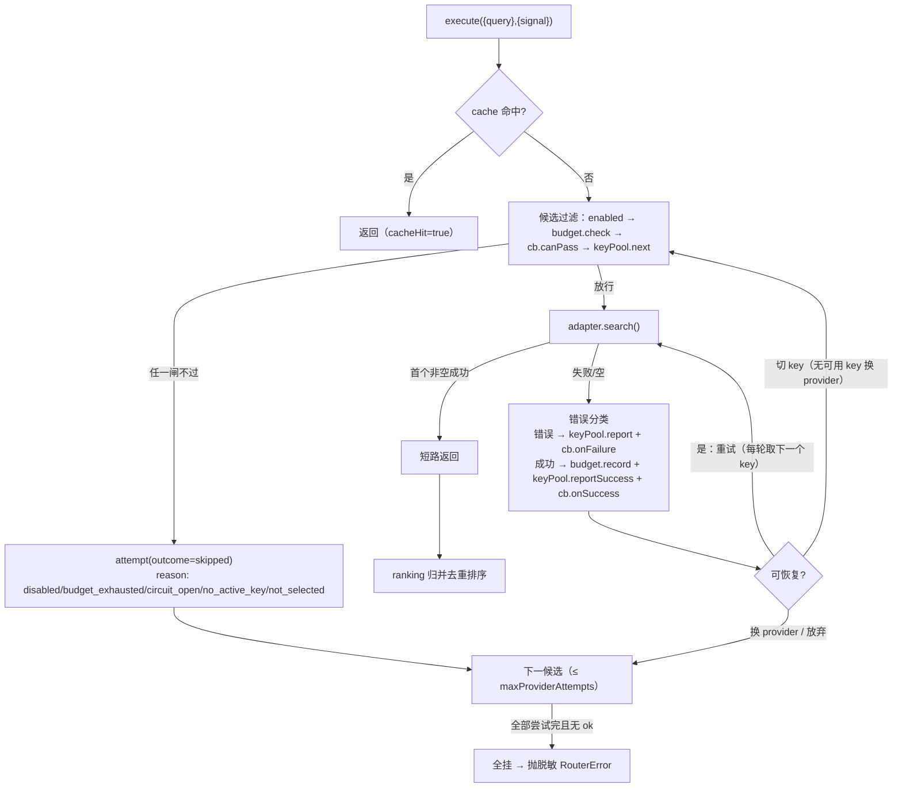
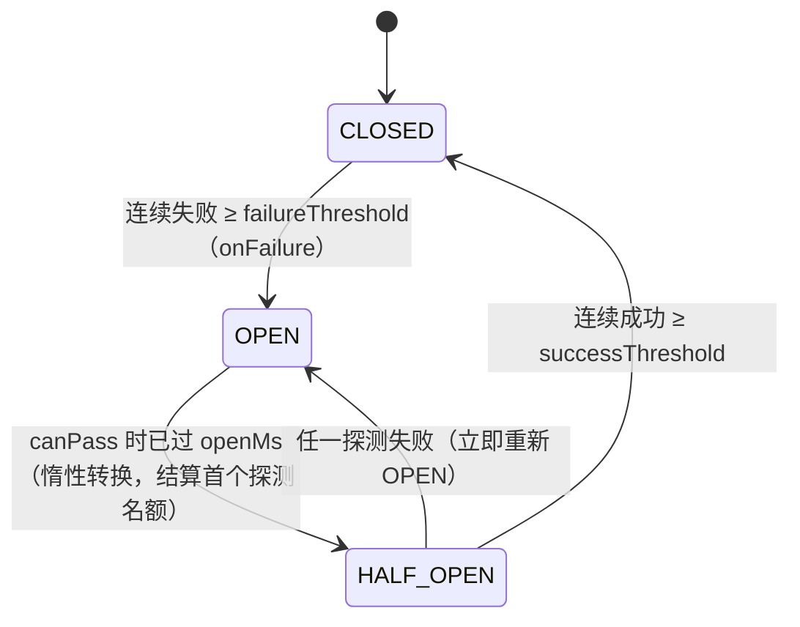

# 路由与故障转移（Router / Circuit Breaker / 排序去重）

> 事实来源：**`src/router.ts`（编排最终事实，含行号引用）**、`src/circuit-breaker.ts`（状态机最终事实）、`src/types.ts` §6、`src/config.ts`（配置默认值）、`src/utils/errors.ts`（错误分类）。
> 本版已对照 `src/router.ts` 完成最终校对（原「待最终校对」6 条见文末 §8）。

## 1. 请求生命周期

补充规则（`docs/architecture.md` §4）：
1. **首个非空成功即短路**（默认）。跨源合并 `routing.merge` 属可选扩展，Phase 2 不做（YAGNI）
2. **全挂才抛错**：`results` 为空且 `attempts` 无 `ok`/`empty` → 抛 **`RouterError`**（`message` 经 `redact()` 聚合各 attempt 的 `provider:code[/status]`，**不是单个 `ProviderError`**，无「单 code 选取」）；部分成功或**空结果属正常返回**，不抛（`router.ts` L472-480）
3. `signal.aborted` → 立即终止，不再切 provider；若尚无任何 attempt → 抛 `RouterError("请求已被调用方取消")`
4. 闸门顺序：`enabled → cache → budget.check → cb.canPass → keyPool.next`（`router.ts` L267-298；缓存命中直接短路，不消耗预算、不打上游、不看 CB/key）

## 2. 策略：priority / round_robin

配置 `routing.strategy`（默认 `"priority"`，非法值 warning 回退）：

| 策略 | 候选顺序 | 适用 |
|---|---|---|
| `priority` | 按 `providers.<id>.priority` **数字小者优先**（默认 10/20/30/40/50/99）；同值冲突已由 config 记 warning，退化为配置枚举序 | 默认：稳定走最优源，逐级 fallback |
| `round_robin` | 已启用的商业 provider 先按 priority 升序排好，再以游标 `k = rrCursor++ % 商业候选数` 旋转起点（`[...slice(k), ...slice(0,k)]`，每 `route()` 前进一格）；**searxng 恒压尾、不占游标**；跨 provider 排序主键 = 本轮尝试顺序（`router.ts` L208-221） | 多 key/多账号均摊配额 |

`routing.maxProviderAttempts`（默认 6，≥1）：单次请求最多**评估**多少个 provider 的**防御性上限**（`router.ts` L439-451）：
- **skipped 计入**（`evaluated++` 对所有非缓存命中的 attempt 生效）
- **缓存命中不计入**
- 超出上限的后续候选**直接 break，不产生任何 attempt 记录**（不会补 `not_selected`）

放行条件逐项：

| 闸 | 不过时的 skippedReason | 依据 |
|---|---|---|
| provider `enabled=false`（未配置 / env 缺 key / schema error） | `disabled` | `config.ts` |
| `budget.check()` 返回 `ok:false` | `budget_exhausted` | `docs/budget.md` |
| `cb.canPass()` 返回 false（OPEN 未到点 / HALF_OPEN 名额用尽） | `circuit_open` | §3 |
| `keyPool.next()` 返回 undefined（key 型且无 active key） | `no_active_key` | `docs/key-rotation.md` |
| 未被策略选中 / 超出 maxProviderAttempts | **不产生 attempt 记录**（直接跳过，`router.ts` L445） | 本节 |
| enabled 但未注册 adapter（`deps.providers` 缺该 id） | `not_selected`（`router.ts` L268） | 本节 |

> searxng 为 `requiresKey=false`：跳过 key 闸（`next()` 为 undefined 不阻断）。

## 3. Circuit Breaker 状态机（每 provider 独立）

`src/circuit-breaker.ts`（实现即事实）：

| 配置 | 默认 | 语义 |
|---|---|---|
| `circuitBreaker.failureThreshold` | `3` | CLOSED 下连续失败次数 → OPEN（`consecutiveFailures` 归零、记 `openedAt`） |
| `circuitBreaker.openMs` | `30000` | OPEN 持续时长；`canPass` 发现 `t - openedAt ≥ openMs` → 转 HALF_OPEN 并放行（`inFlight=1`） |
| `circuitBreaker.halfOpenMaxCalls` | `1` | HALF_OPEN 允许的并发探测数；`inFlight < halfOpenMaxCalls` 才放行，否则 false → skipped |
| `circuitBreaker.successThreshold` | `2` | HALF_OPEN 连续成功 → CLOSED |

关键语义：
- **只统计 `SERVER_ERROR` / `NETWORK_ERROR` / `TIMEOUT`**（`countsTowardCircuit`）；`AUTH`/`RATE_LIMIT`/`QUOTA_EXCEEDED` 由 key-pool/budget 处理，`BAD_REQUEST`/`UNKNOWN` 不计——否则会把「单 key 坏了」误判成「provider 挂了」
- `onFailure(provider, code)`：code 不计入 → 返回 false 不动状态；OPEN 中的迟到失败 → 忽略；OPEN 中的迟到成功 → 忽略（`onSuccess` 在 OPEN 态不改状态）
- `view()/views()` 暴露 `CircuitBreakerView`（`state`、计数、`openedAt`、`nextProbeAt = openedAt + openMs`），供诊断输出
- `reset(provider?)` 测试/重载用
- key-pool 的 `thresholdExceeded()`（provider 级 5xx 连续计数 ≥ `keyPool.errorThreshold`）同样喂给 `cb.onFailure` → 「全 key 轮过仍失败」也算一次熔断失败

## 4. 错误分类决策表（router 的「切 key / 换 provider / 放弃」）

`src/utils/errors.ts classifyStatus`（**按 provider 分派，禁止全局一刀切**）：

| 信号 | ErrorCode | key 动作 | provider 动作 | 计 CB? |
|---|---|---|---|---|
| 401；403（key 型 provider） | `AUTH` | 该 key → `disabled` | 换同 provider 下一个 key；无可用 → 换 provider | 否 |
| 403 + `provider=searxng` | `UNKNOWN` | 不动 | 换 provider（此时已无更后候选 → 本轮结束） | 否（`UNKNOWN` 不计，防 SearXNG 403-HTML 误开电路） |
| 403 + `provider=tavily` | 响应体含 auth 语义 → `AUTH`，否则 `UNKNOWN` | 视分类 | 视分类 | 视分类 |
| 429 | `RATE_LIMIT` | 冷却（Retry-After 优先） | 换下一个 active key（`hasActive` → `continue`；无可用 → 换 provider） | 否 |
| 402 / 上游额度信号 | `QUOTA_EXCEEDED` | 该 key `disabled` | budget.markExhausted("provider") → 换 provider | 否 |
| 400 / 404 / 422 | `BAD_REQUEST` | 不动 | **不重试**，直接换 provider | 否 |
| **408** | `classifyStatus` 输出 `UNKNOWN` → **router 出厂归一为 `SERVER_ERROR`**（`router.ts` L244，按 retryable 处理） | 参与重试轮转 | 退避后重试 | **是** |
| 5xx | `SERVER_ERROR` | 每轮重试由 `keyPool.next()` 取下一个 active key（非固定同 key），共 `retry.maxAttempts = http.retriesPerKey + 1` 次 | 全 key 轮过/次数用尽 → 换 provider | **是** |
| fetch/DNS/TLS 失败 | `NETWORK_ERROR` | 同上（重试轮转） | 同上 | **是** |
| AbortController 超时 | `TIMEOUT` | 同上（重试轮转） | 同上 | **是** |
| 其余（含 SearXNG 403-HTML） | `UNKNOWN` | 不动 | 换 provider | 否 |

退避：重试轮之间按 `backoffDelay(n, retryBackoffMs, maxRetryBackoffMs, retryAfterMs)` 指数退避（基数默认 400ms、封顶默认 8000ms）；429 的 `Retry-After` 优先作用于当前 key 冷却（key-pool），健康 key 立即轮换不阻塞。

## 5. SearXNG 作为最终 fallback

- 默认 `priority: 99`（六家中最大）→ priority 策略下**永远排最后**
- 无 key、无上游额度概念 → 不受 key 闸与常见 budget 限制（仍可配 `{scope:"provider", target:"searxng", limit:N}` 防实例滥用）
- 403-HTML（实例禁用 `format=json`）→ `UNKNOWN` → 换 provider（此时已无更后候选 → 本轮结束）
- 意义：**key 型 provider 全挂（401 全禁用、429 全冷却、熔断 OPEN）时，searxng 仍可能出结果**，避免直接抛错

## 6. 排序与去重（`ranking`，`docs/architecture.md` §5）

约束：**原生 score 禁止跨 provider 比较**——6 家中仅 Tavily（0..1）与 SearXNG（融合分）有 score，Exa/Parallel 响应无 score 字段，SerpApi 用 `position`，You 靠数组顺序。

排序键（字典序）：

1. **provider 层级** — 本次命中 provider 的 `priority`（round_robin 下按本轮尝试顺序）
2. **provider 内 `rank`** — 数组原始顺序（1 起）
3. **新鲜度 `time.published`** — 有则新者在前（同层兜底）

`score` 只作同 provider 内稳定 tie-break，不参与跨层比较。

去重：URL 规范化（去 fragment、去默认端口、query 参数排序、host 小写、尾斜杠归一）后以规范化 URL 为键，**保留首次出现**（层级高者优先）。

## 7. 全挂才抛错

- 每个被评估的候选都会产出一条 `ProviderAttempt`（`outcome: ok|empty|error|skipped`，含 `skippedReason`/`latencyMs`/`resultCount`/`error`；超出 `maxProviderAttempts` 的候选不进轨迹）
- 只要存在 `outcome=ok` 或 `empty`（含空结果）→ 正常返回 `SearchResponse`（`results` 可为空数组）
- `attempts` 中**无任何 `ok`/`empty`**（全部 error/skipped）→ 抛 **`RouterError`**（不是 `ProviderError`）：
  - `message` = `aggregateMessage(attempts)`：按轨迹顺序拼 `provider:code[/httpStatus]`（skipped 拼 `provider:skipped(reason)`），整体过 `redact()`，**不含 key、不含带 query 的 URL**（`router.ts` L146-157、L472-480）
  - `attempts` 字段原样携带；`provider` = 首个带 error 的 attempt 的 provider
  - **不存在「单个 code 取首个/最高严重度」的选取规则**——全挂错误以聚合 message 呈现
- 此时 OpenCode 层的内置 429 冷却才会接管（与内部方向一致，不冲突）

---

## 8. 最终校对结论（对照 `src/router.ts`，原「待最终校对」6 条）

1. **切 key / 换 provider 判定顺序**（`router.ts` L405-425）：`switch (err.code)` 单一分派，优先级 `BAD_REQUEST/UNKNOWN`（不重试不切 key，直接换 provider）→ `AUTH/RATE_LIMIT`（key 动作已由 key-pool 完成，`hasActive` → `continue` 取下一个 key；无可用 → 换 provider）→ `QUOTA_EXCEEDED`（`budget.markExhausted` → 换 provider）→ default（`SERVER_ERROR/NETWORK_ERROR/TIMEOUT`：`n < retry.maxAttempts` 则退避后 `continue`，否则换 provider）。**重试计数**：单 provider 共 `retry.maxAttempts = http.retriesPerKey + 1` 轮（默认 3），`continue` 每次消耗一轮；每轮经 `keyPool.next()` 取**下一个 active key**（round-robin），不存在固定「同 key 重试」。
2. **UNKNOWN 不计 CB**：`circuitBreaker.onFailure` 走 `countsTowardCircuit`，仅 `SERVER_ERROR/NETWORK_ERROR/TIMEOUT` 计数（`router.ts` L401、`errors.ts` L101-103）。架构 §6.1「UNKNOWN 计一次 CB 失败」与代码冲突，**以代码为准**（已回写 `architecture.md`）；HALF_OPEN 下非计数型错误按 `onSuccess` 结算探测名额（L402），避免名额泄漏。
3. **短路截断**：命中成功即 `break`，**后续候选不评估、不产生 attempt 记录**（不补 `not_selected`）；`not_selected` 仅用于 enabled 但未注册 adapter（L268）。
4. **round_robin 轮转**：商业候选先按 `priority` 升序（平手按 `PROVIDER_IDS` 枚举序），再 `k = rrCursor++ % N` 旋转起点；searxng 恒压尾、不占游标（L208-221）。排序主键 = `rankAndDedupe` 的 `groups` 数组序（= 本轮尝试顺序）→ provider 内 rank → `time.published`（L119-143）。
5. **maxProviderAttempts 计入 skipped、不计缓存命中**：非缓存命中的 attempt（含 skipped）一律 `evaluated++`；达上限直接 break（L439-451）。
6. **全挂抛 `RouterError`**：无单个 `ProviderError.code` 选取；`message` 按 attempt 轨迹顺序聚合各 code（`aggregateMessage`，L146-157），`RouterError.provider` = 首个失败 attempt 的 provider（L94-103）。
